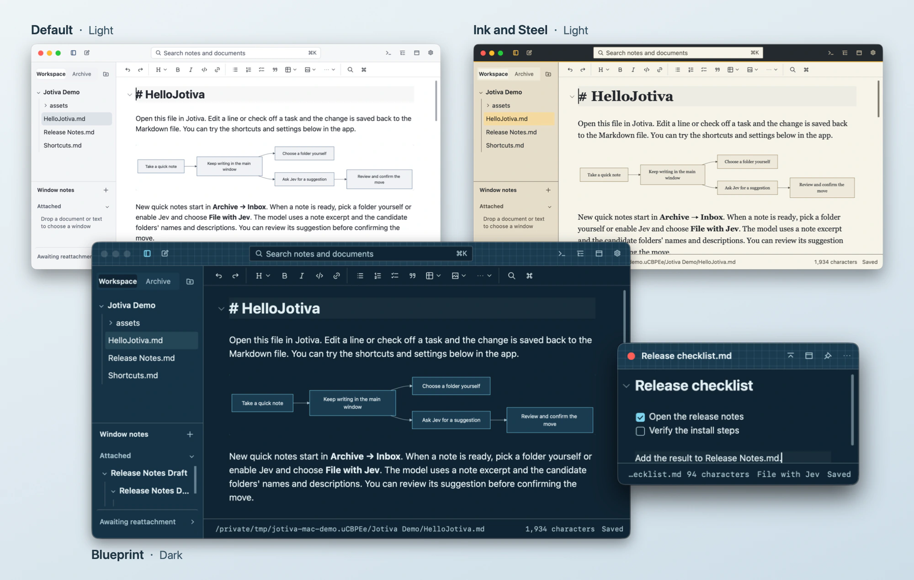

Jotiva `0.2.0` 围绕**便签速记、Jev 管理、脱离鼠标、即时渲染、图片管理**五大核心体验进行了全面升级：新增目录级图片管理、文档感知的内置终端、预览标签与标签批量操作、主题管理与全局 CSS 微调、中英双语即时切换以及应用内签名更新，并将底层编辑器引擎升级至 `@jot-md/editor` `v0.4.1`。

---

## 新功能

- **目录级图片管理**：新增「设置 → 图片管理」与文件夹右键「图片管理…」，支持按目录配置三种存图方式——**跟随文档**（存入文档旁子目录如 `_assets`，支持按文档名建子目录）、**固定共用目录**（支持相对路径，适合博客/工程统一存放配图）与 **HTTP 图床上传**（支持自定义表单字段、JSON Pointer 与系统凭据库密钥）。子目录自动继承最近一层已配置的上级目录规则，并支持同名自动编号与可选的静态 PNG / JPEG 体积压缩。
- **文档感知的内置终端**：在主窗口按 `` Ctrl+Shift+` `` 即可在当前文档或侧栏所选项所在目录打开或切回终端，也可右键文件夹/标签选择「在此处新建终端」。支持多会话并行、切换标签页不断连、按 `F2` 重命名会话、拖入文件自动插入转义路径，以及在脚本中通过 `JOTIVA_INBOX_DIR` 环境变量把生成的 `.md` 直接送入收件箱。
- **主题管理、新内置主题与全局 CSS 微调**：
  - 新增 **Material** 与 **蓝晒（Blueprint）** 两套内置明暗主题，Mermaid 图表（流程图、时序图、甘特图等）现在会自动跟随当前主题配色。
  - 支持在「设置 → 界面外观 → 我的主题」中导入、重命名与同名热更新 `.css` 主题文件。
  - 新增「**全局样式微调**」，支持在设置内直接编写、一键格式化并保存跨主题生效的自定义 CSS。
- **预览标签与标签页批量操作**：
  - 单击侧栏文件默认以斜体**预览标签**打开，继续浏览其他文件时自动复用，防止标签页无限堆积；双击、开始编辑或右键选「保留标签」即可固定（可在「设置 → 编辑选项」关闭）。
  - 标签页右键菜单新增**复制文档内容**、**制作副本**、**在此处新建终端**、**在新窗口打开**，以及**关闭左侧 / 右侧 / 其他标签**等批量操作。
- **中英双语即时切换（i18n）**：新增英文桌面界面与原生菜单支持，可在「设置 → 界面外观 → 界面语言」中实时切换**简体中文**与 **English**，所有已打开窗口立即生效。
- **应用内签名更新**：新增「设置 → 软件更新」与后台自动检查。从本版本起，启用更新签名的 macOS、Windows 与 Linux AppImage 安装包支持在应用内检查并安装更新（重启前自动保存已打开文档，有运行中的终端会话时会先弹窗确认）。

## 功能优化与问题修复

- **随窗便签速记体验优化**：统一全局快捷键 `Control+Shift+Space` 与便签菜单里的「新建便签」的创建链路——在同一窗口再次按下快捷键会直接新建一张独立便签；切回原宿主窗口时，挂在该窗口下的已保存便签会一并恢复显示。
- **全局搜索覆盖未打开文件与滚动懒加载**：`⌘K` / `Ctrl+K` 搜索现可直接检索工作区和归档目录中尚未打开的本地文档文件名，并将结果列表由分页改为**滚动连续懒加载**。同时补充了归档目录重命名后仍能参与 Jev 归档建议的回归测试。
- **侧栏新建文件防丢失优化**：新建文件时立即落盘并进入原位重命名（重名自动追加序号），中文输入法选词或意外失焦时，即使还没按 `Enter`，文件也已经创建。
- **脱离鼠标的快捷键扩充**：新增切换任务列表（`⌃⇧9` / `Ctrl+Shift+9`）、勾选或取消待办完成状态（`⌘⌥Enter` / `Ctrl+Alt+Enter`）默认快捷键，并在快捷键设置中支持绑定「重排有序列表编号」等操作。
- **跨平台窗口与细节打磨**：统一 Windows 与 Linux 的自绘标题栏布局，调整各平台的标题栏细节与设置页卡片间距；Windows 与 Linux 主窗口在窄宽度下会自动将搜索栏收拢为紧凑图标。
- **编辑器核心引擎升级（`@jot-md/editor` `v0.3.1` → `v0.4.1`）**：同步升级底层 Markdown 编辑器组件，包含本地图片选取与粘贴钩子、工具栏交互和待办失焦样式等改进，并修复 WebKit 中鼠标点击「选择本地图片」无法打开文件选择框的问题。组件详细变更请查看 [jot-md-engine Releases](https://github.com/lin037/jot-md-engine/releases)。

---

## 下载与升级说明

- 若你正在使用 `0.1.1`，请从下方下载对应平台的新版安装包完成升级。从 `0.2.0` 起，macOS、Windows 和 Linux AppImage 版可直接在「**设置 → 软件更新**」中检查并安装后续签名更新。Linux DEB 用户请从 Releases 页面下载新版安装包。
- 本版 macOS 安装包未经 Apple 公证，Windows 安装包没有发布者签名。系统可能在首次打开时提示。macOS 更新后若需要重新授权辅助功能，可以在「**设置 → 窗口关联**」重新发起授权。[Apple 打开应用说明](https://support.apple.com/zh-cn/102445)
- 下载区的 `HelloJotiva.zip` 包含中英文示例笔记与本地配图，解压后用 Jotiva 打开即可体验窗口挂载、表格、待办、LaTeX 公式与 Mermaid 图表。所有安装包与示例均可通过 `SHA256SUMS` 校验。

[使用手册](https://github.com/lin037/jotiva/blob/main/docs/user-guide.md) · [快捷键参考](https://github.com/lin037/jotiva/blob/main/docs/shortcuts.md) · [主题定制](https://github.com/lin037/jotiva/blob/main/docs/themes.md) · [反馈问题](https://github.com/lin037/jotiva/issues/new/choose)

---

## English

Jotiva `0.2.0` brings major upgrades across **Window-Attached Quick Notes, Jev Smart Filing, Mouse-Free Workflow, Instant Live Rendering, and Per-Folder Image Management**—introducing per-folder image storage rules, a document-aware integrated terminal, preview tabs and batch tab actions, CSS theme management with global CSS tweaks, live English / Simplified Chinese switching, signed in-app updates, and an upgrade to `@jot-md/editor` `v0.4.1`.

### New Features

- **Per-Folder Image Management**: Configure image storage globally under **Settings → Images** or per folder via **Image settings…**—choose **Beside the document** (e.g., `_assets` or per-document subfolders), **Shared directory** (with relative path support), or **HTTP upload** (custom form field, JSON Pointer, and OS keyring bearer token). Subfolders inherit the nearest configured parent rule automatically, with duplicate numbering and optional static PNG/JPEG compression.
- **Document-Aware Integrated Terminal**: Press `` Ctrl+Shift+` `` to open or return to a terminal for the current document or sidebar selection, or right-click a folder/tab and choose **New terminal here**. Supports multiple persistent sessions across tab switches, session renaming (`F2`), dragging files to insert escaped paths, and writing to `JOTIVA_INBOX_DIR` to send generated `.md` files straight into your Inbox.
- **Theme Management, New Built-in Themes & Global CSS Tweaks**:
  - Added **Material** and **Blueprint** light/dark themes. Mermaid diagrams now automatically follow your active theme palette.
  - Import, rename, and update single-file `.css` themes in place under **Settings → Appearance → My themes**.
  - Write, format, and save **Global CSS tweaks** that persist across theme switches.
- **Preview Tabs & Batch Tab Actions**:
  - Single-click a file in the sidebar to preview it in a reusable tab; double-click, edit, or choose **Keep tab** to pin it (configurable in **Settings → Editor**).
  - Right-click any tab to **Copy document text**, **Duplicate document**, **New terminal here**, **Open in new window**, or **Close tabs to the left / right / others**.
- **Live Bilingual UI (i18n)**: Switch between **English** and **简体中文** on the fly under **Settings → Appearance → Interface language** across all open windows and native menus.
- **Signed In-App Updates**: Added **Settings → Software updates** and background update checks for macOS, Windows, and Linux AppImage builds configured for signed updates, automatically saving open documents and confirming active terminal sessions before restarting.

### Improvements & Fixes

- **Unified Quick Note Creation & Multi-Note Restore**: Pressing `Control+Shift+Space` again on the same window (or clicking the new-note button in a quick note) now consistently creates a separate note attached to that window, and saved notes bound to a host window restore together when you switch back.
- **Unopened File Search & Continuous Scrolling**: `Cmd+K` / `Ctrl+K` now finds unopened files across your Workspace and Archive folders by filename, replacing pagination with smooth infinite scrolling. Added regression coverage for renamed archive folders remaining eligible for Jev filing suggestions.
- **Reliable Inline File Creation**: Creating a new file writes an empty file on disk immediately during inline naming, so the file is already created if IME composition or a focus change leaves the name unconfirmed.
- **Expanded Keyboard Shortcuts**: Added default shortcuts for toggling task lists (`Ctrl+Shift+9`) and task completion (`Cmd+Option+Enter` / `Ctrl+Alt+Enter`), plus assignable actions such as renumbering ordered lists.
- **Cross-Platform Window Polish**: Aligned custom title bars on Windows and Linux, and refined title-bar details and settings cards across platforms; narrow Windows and Linux main windows automatically collapse the search bar into a compact button.
- **Editor Engine Upgraded (`@jot-md/editor` `v0.3.1` → `v0.4.1`)**: Upgraded the core Markdown editor component with image paste/picker hooks, toolbar refinements, and unfocused task-item styling improvements. Also fixed mouse clicks on the local image option failing to open the file picker in WebKit. See the full component changelog at [jot-md-engine Releases](https://github.com/lin037/jot-md-engine/releases).

### Downloads & Upgrading

If you are upgrading from `0.1.1`, download the installer for your platform below. Starting with `0.2.0`, macOS, Windows, and Linux AppImage builds support signed in-app updates under **Settings → Software updates** (Linux DEB users can download new `.deb` packages from Releases). Unzip `HelloJotiva.zip` to try the bilingual sample notes and local assets, and verify downloads against `SHA256SUMS`.

The macOS installers are not notarized by Apple, and the Windows installer has no publisher signature. The system may show a prompt when you first open one. If macOS asks for Accessibility access again after an update, request it under **Settings → Window attachments**. [Apple’s guide to opening apps](https://support.apple.com/en-us/102445)

[User Guide](https://github.com/lin037/jotiva/blob/main/docs/en/user-guide.md) · [Shortcuts](https://github.com/lin037/jotiva/blob/main/docs/en/shortcuts.md) · [Themes](https://github.com/lin037/jotiva/blob/main/docs/en/themes.md) · [Report an Issue](https://github.com/lin037/jotiva/issues/new/choose)

## 安装包 / Downloads

| 平台 / Platform | 安装包 / Package |
| --- | --- |
| macOS 14+ (Apple Silicon, Intel) | Universal DMG, PKG, ZIP |
| Windows x64 | NSIS `-setup.exe` |
| Linux x86_64 | DEB, AppImage (Ubuntu 24.04 build) |
