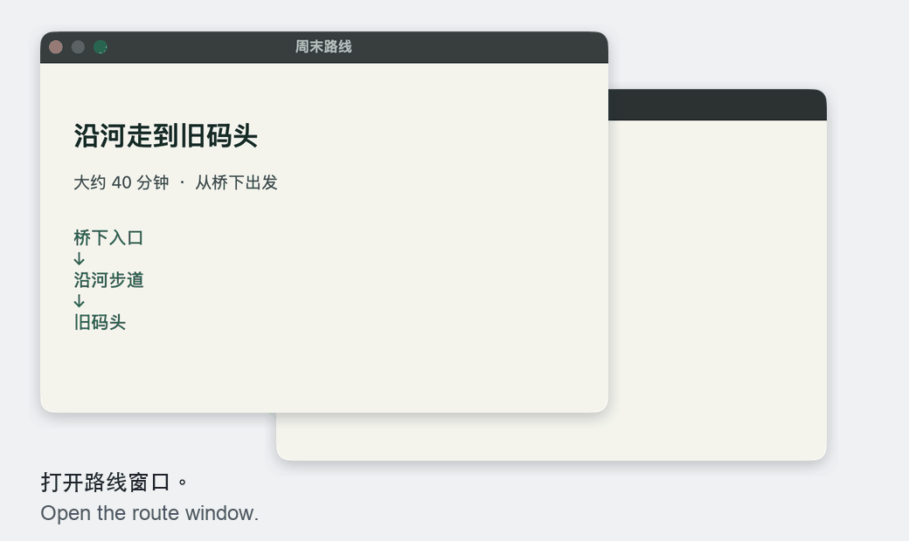

  

<h1 align="center">Jotiva</h1>

<strong>A note that stays with the window you opened it for.</strong>

  <a href="https://github.com/lin037/jotiva/releases"><strong>Download</strong></a> ·
  <a href="docs/en/user-guide.md">User guide</a> ·
  <a href="docs/en/developer-guide.md">Developer guide</a> ·
  <a href="README.md">中文</a>

## See it in action

You're looking up a route and want to remember where to turn. Open a quick note beside the map. Switch to your messages and the note gets out of the way. Go back to the map and the same note is right where you left it.

  <picture>
    <source media="(prefers-reduced-motion: reduce)" srcset="docs/assets/window-notes.webp">
    
  </picture>

Two windows in the same app can have different notes. Pin a note when you want to see it across windows. Window attachment works on macOS, Windows, and compatible Linux X11 sessions. On native Wayland, you can open a note in its own window. [Setup and shortcuts](docs/en/user-guide.md#take-a-note-beside-another-app)

## Write in the files you already have

Open a Markdown or UTF-8 text file and edit it in place. Check off tasks and change table cells in Live Preview, or switch to Markdown source. Add a folder to the sidebar, jump through long documents with the outline, or put two files side by side.

Try it on the sample note. Download it, open it in Jotiva, and check something off or change the route in the table. Your changes go back into the file you downloaded. [HelloJotiva.md](docs/HelloJotiva.md)

If you find Jotiva useful, a star helps other people find it. Tell us how you use it or what gets in your way. [Discussions](https://github.com/lin037/jotiva/discussions) · [Contributing](CONTRIBUTING.md) · [MIT license](LICENSE)
