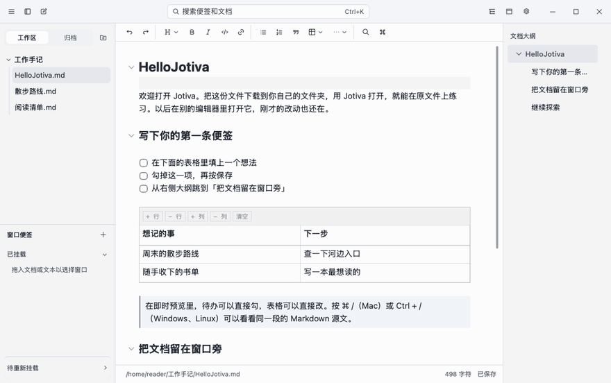
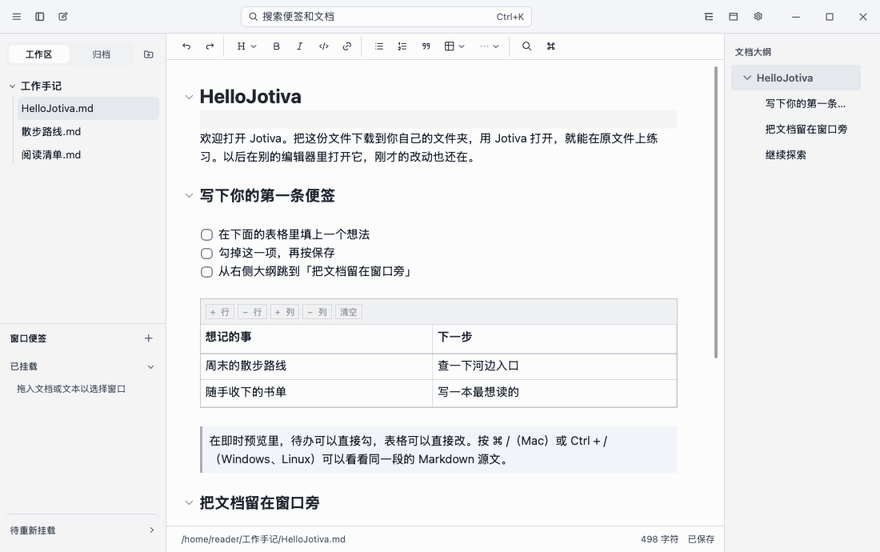

  

<h1 align="center">Jotiva</h1>

<strong>把笔记留在你正在工作的窗口旁。</strong>

原地编辑 Markdown 和纯文本，适用于 macOS、Windows 和 Linux。

  <a href="https://github.com/lin037/jotiva/releases"><strong>下载安装</strong></a> ·
  <a href="docs/HelloJotiva.md">试写 HelloJotiva</a> ·
  <a href="docs/user-guide.md">使用手册</a> ·
  <a href="docs/developer-guide.md">开发者指南</a> ·
  <a href="docs/en/user-guide.md">English</a>

  
  
  
  
  
  
  

  <picture>
    <source media="(prefers-color-scheme: dark)" srcset="docs/assets/jot-dark.webp">
    
  </picture>

- **写完就存回原文件。** 从你的文件夹打开 Markdown 或 UTF-8 文本。用即时预览勾待办、改表格，也可以随时切回 Markdown 源码。
- **让便签跟着工作窗口。** 查资料时把文档挂到浏览器旁。切走时继续工作，回到原窗口就能接着记。支持 macOS、Windows 和兼容的 Linux X11 会话。
- **把一叠资料展开来写。** 用工作区浏览现有文件夹，在标签、大纲和搜索之间切换，也能把两份文档各开一扇窗口对照。写累了，换成深色或导入自己的 CSS。

## 看看怎么用

勾待办、给表格加一行，再切换到 Markdown 源码

搜索本地便签和文档

想自己试一遍？打开 [HelloJotiva.md](docs/HelloJotiva.md)，点右上角下载，再用 Jotiva 打开。安装、文件存放位置和各平台的快捷键都能从 [使用手册](docs/user-guide.md) 找到。

觉得 Jotiva 适合你的写作方式，欢迎点个 **Star**。有想改进的细节，也欢迎来 [讨论区](https://github.com/lin037/jotiva/discussions) 分享你的用法，或从 [贡献指南](CONTRIBUTING.md) 开始。
