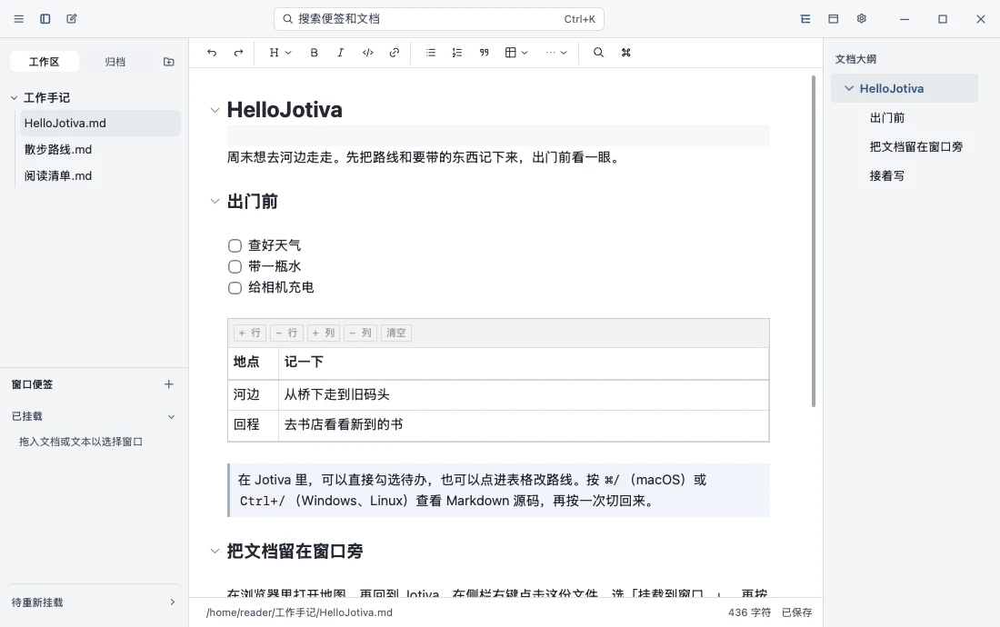

<h1 align="center">Jotiva</h1>

在 macOS 上原地编辑 Markdown，把手边的文档留在工作窗口旁。

<a href="https://github.com/lin037/jotiva/releases/latest"><strong>下载</strong></a> ·
<a href="docs/user-guide.md">使用手册</a> ·
<a href="showcase/README.md">示例文档</a> ·
<a href="docs/developer-guide.md">开发者指南</a> ·
<a href="docs/en/user-guide.md">English</a>

  <picture>
    <source media="(prefers-color-scheme: dark)" srcset="docs/assets/jot-dark.webp">
    
  </picture>

## 在 Jotiva 里写作

- **直接编辑 Markdown。** 从 Finder 打开文件，即时预览里可以勾待办、改表格，也可以按 `⌘/` 切到源码。改动保存回原文件。
- **把便签挂在工作窗口旁。** 开会或查资料时，按 `⌃⇧空格` 记一笔，按 `⌘↩` 把键盘交还原窗口。切回时，便签会跟着回来。窗口关联需要 macOS 辅助功能权限。
- **把常用资料放在手边。** 将本地文件夹加入侧栏，在标签、大纲和搜索之间切换。需要对照两篇文档时，可以打开独立窗口并排看。

## 开始使用

Jotiva 支持 macOS 14 及更新版本。打开 Jotiva 后，按 `⌘O` 选一份 `.md` 文件。想试试表格和大纲，可以打开 [梧桐街开放日示例](showcase/README.md)。

在设置中可以切换深浅色、导入 CSS 和重新录入快捷键。常用操作和文件保存位置见 [使用手册](docs/user-guide.md)。想参与开发，读 [开发者指南](docs/developer-guide.md)。

源码提供 Windows 和 Linux 桌面适配。Windows 支持原地编辑 Markdown 和 UTF-8 文本文件，并可将文档拖到其他应用窗口挂载，Linux 支持文档工作区和独立便签，兼容 EWMH 的 X11 会话还支持外部窗口关联。各平台构建环境与功能差异见 [开发者指南](docs/developer-guide.md) 和 [平台能力表](docs/architecture.md#桌面平台边界)。 [Windows 反馈](https://github.com/lin037/jotiva/issues/new?template=windows.yml) · [参与贡献](CONTRIBUTING.md)
