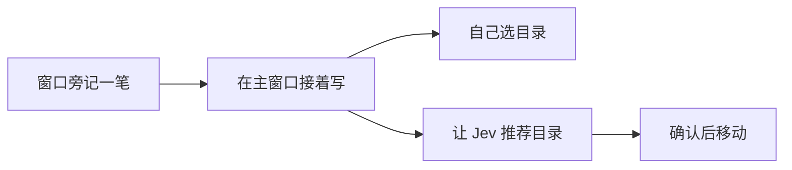

# HelloJotiva

在 Jotiva 打开这份文件，改几行字、勾掉一项待办，改动就会存回这份 Markdown。下面的键位和设置都可以在应用里试。

## 在窗口旁记一笔

在支持窗口挂载的桌面上，打开一个空白浏览器窗口，按 `Control+Shift+Space` 叫出便签。记下你想先试的快捷键，写完按 `⌘Enter`（macOS）或 `Ctrl+Enter`（Windows / Linux），就能回到浏览器接着操作。

## 回到主窗口接着写

在便签菜单里选「在主窗口编辑」，打开的还是刚才那份文件。下面是几组默认键位，试着在表格的最后一列加一句备注。点进单元格就能改，`Tab` 去下一格，`Shift+Tab` 回上一格。

| 想做什么 | macOS | Windows / Linux | 备注 |
| --- | --- | --- | --- |
| 查找便签和文档 | `⌘K` | `Ctrl+K` |  |
| 切换即时预览和源码 | `⌘/` | `Ctrl+/` |  |
| 在正文、文件树和大纲之间切换 | `F6` | `F6` |  |
| 保存 | `⌘S` | `Ctrl+S` |  |

- [ ] 切到源码看一眼，再切回即时预览。
- [ ] 用搜索找到刚才记下的便签。

## 写完放到哪儿

新建的速记先存在「归档 → 其他」。写完可以自己挑个目录，也可以在启用 Jev 后点「用 Jev 归档」。模型会根据正文摘录和候选目录的名称、用途给出建议，等你确认才移动文件。



## 把正文字号调小一点

默认主题会把基础字号乘以 $1.13$ 作为正文字号。基础字号设为 14 px 时，正文大约是 15.8 px。

$$
s_{\mathrm{body}} = 14\,\mathrm{px} \times 1.13 = 15.82\,\mathrm{px}
$$

想让主窗口和独立文档窗的正文比基础字号小 1 px，可以在「设置 → 界面外观 → 全局样式微调」里保存这段 CSS。

```css
:root {
  --jot-editor-font-size: calc(1rem - 1px);
}
```

## 带上文档里的图片

这张抽象图以 Jotiva 的「蓝晒」主题配色为参考。图用的是本地相对路径，复制笔记时把同目录下的 `assets/hello-jotiva/` 一起带上，离线也能看到。


