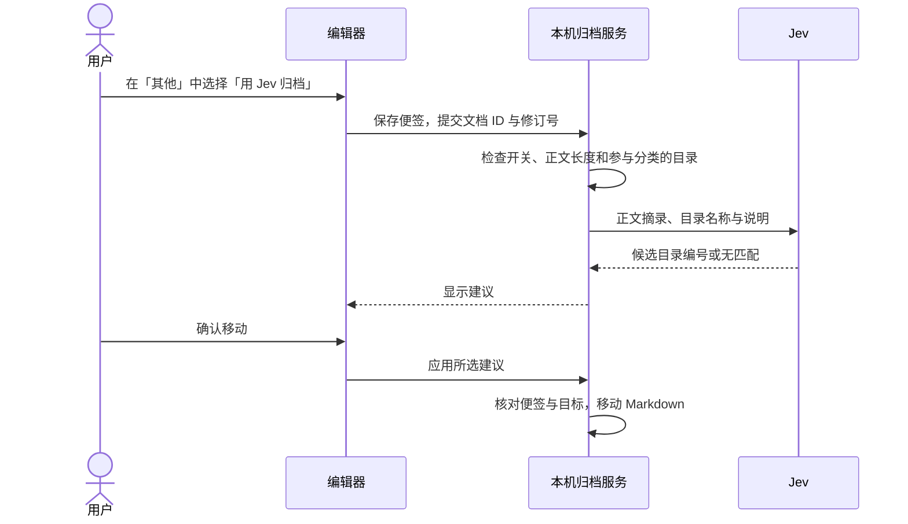

# Jotiva 实现说明

[开发者指南](developer-guide.md)

## 桌面平台边界

文档库负责保存正文和修订记录，Tauri 管理 Jotiva 自己的窗口与菜单，各平台的宿主适配器负责识别其他应用的窗口。文档 ID 独立于窗口句柄。因此，关闭原来的窗口后，仍可以重新挂载便签，也可以在另一个窗口打开同一份文档。

| 能力 | macOS | Windows | Linux |
| --- | --- | --- | --- |
| 主窗、设置、独立文档 | AppKit 标题栏，主窗叠加系统红绿灯 | 自绘标题栏、右侧窗口控制、应用菜单、WebView2 | 自绘标题栏、应用菜单、WebKitGTK |
| 快捷键、设置与退出 | ⌘ 主键，应用菜单含设置与退出 | Ctrl 主键，工具菜单含设置，文件菜单含退出 | 同 Windows，全局快捷键依赖桌面会话 |
| 浮窗与宿主 | NSPanel、Spaces、Accessibility 及原有身份恢复 | Win32 枚举、选择、监听前台和关闭事件；同一运行期间按窗口关联 | X11 通过 EWMH 枚举、关联与监听外部窗口；原生 Wayland 会话使用独立便签 |
| 在文件管理器中定位 | Finder 选中文件 | Windows Shell 定位并选中文件 | Tauri opener 调用桌面文件管理服务 |
| 保存时检验被替换的版本 | Darwin 文件交换 | ReplaceFileW 保留被替换的文件 | Linux renameat2 文件交换 |
| Jev 凭据 | 钥匙串 | Windows 凭据管理器 | 使用 Secret Service、secret-tool 和 zenity |

业务代码通过 `platform` 调用系统功能。`HostBackend` 定义如何与宿主窗口交互，`FileManager` 定义文件管理操作。三个系统各有自己的模块，`shared` 放共用的 Tauri 实现。编译时选择对应模块，创建窗口时把平台信息传给前端。添加桌面功能时，先查 Tauri 是否已有接口。系统专用的操作放在适配器里，业务层仍使用同样的命令和数据格式。 [平台模块](../src-tauri/src/platform/mod.rs) · [接口定义](../src-tauri/src/platform/contract.rs) · [前端配置](../src/desktop/platform.ts)

## 窗口与编辑器

所有窗口共用同一个 HTML 入口，TypeScript 根据 Tauri 的窗口标签加载视图。主窗口是 `main`，设置是 `settings`，速记是 `quick` 或 `quick-*`，独立文档是 `document-*`。主窗口只运行当前标签的编辑器和 Worker。切走时会先保存正文，再保留撤销快照、选区、阅读位置和编辑模式。每开一个独立文档窗口，就会新建一份编辑会话。

速记由 `desktop.rs` 协调，额外速记窗在 `desktop/note_windows.rs` 管理。Rust 用递增的 `epoch` 标记视图切换，WebView 在准备好编辑、摘要或搜索界面后用同一个编号确认。旧确认会被丢弃。折叠便签后可回收 Worker，隐藏窗口经过空闲期后可销毁 WebView。仅菜单栏常驻时仍可以用热键唤起。 [窗口事件定义](../src-tauri/src/events.rs)

macOS 用 AppKit 和 Accessibility 监听其他应用的窗口，Windows 用 Win32，Linux 用 X11/EWMH。macOS 能确认是同一个窗口时，可以恢复挂载。Windows 和 Linux 的窗口标识只在当前会话里有效。关联窗口关闭后，可在「待重新挂载」里为便签重新选一个窗口。窗口列表可以按标题筛选。切回原窗口时，便签会重新显示，键盘焦点仍在原窗口。 [宿主代码](../src-tauri/src/host.rs)

## 文档怎样保存

1. 输入先到编辑器，延时保存会等待 Worker 确认正文。切换、关闭和退出也会先处理待保存的输入。
2. Rust 用文档 ID 找到记录，检查版本及磁盘内容。替换 Markdown 前在同目录写入临时文件，检查旧内容后替换目标。记录提交失败时尝试恢复原文件。
3. Jotiva 的其他窗口收到更新后可以读取新版本。若本地和另一窗口修改了不同范围，前端会尝试合并。遇到重叠、外部编辑产生的保存冲突或目标无法读取时，界面可以把尚未保存的输入另存到「其他」。
4. 便签从「其他」移到用户目录时保留文档 ID。文档绑定与文件位置独立，解除挂载后仍能打开原文。

[编辑会话](../src/editor/note-editor.ts) · [文本合并](../src/editor/document-sync.ts) · [文件写入](../src-tauri/src/storage.rs)

## 本地数据

应用数据目录由 Tauri 的 `app_data_dir()` 解析。macOS 使用 `~/Library/Application Support/io.github.lin037.jot.desktop/`，Windows 使用 `%APPDATA%\io.github.lin037.jot.desktop`，Linux 默认使用 `$XDG_DATA_HOME/io.github.lin037.jot.desktop`（通常位于 `~/.local/share`）。

| 路径 | 内容 |
| --- | --- |
| `notes/其他/*.md` | 默认归档中的真实文档。新建的无名速记在首次保存正文后写入。 |
| `notes/<id>.json` | 便签正文快照、修订号、标题、归档路径和来源。 |
| `notes/window-bindings.json`、`notes/sources.json` | 窗口身份与手动登记的来源。 |
| `notes/closing-sources/` | 解除来源时的中间状态，用于下次启动继续处理。 |
| `workspace.json`、`folders.json` | 工作区目录，归档名称、路径、说明和分类选择。 |
| `appearance.json`、`settings.json` | 外观和快捷键。快捷键设置保存三项全局键位及用户改过的应用内键位。 |
| `filing.json` | Jev 归档开关、服务地址和模型名称。密钥由各平台的系统凭据存储管理。 |

归档设置页用表单里的服务地址查询密钥。WebView 只会收到有没有配置密钥，或查询失败的原因。添加和更换密钥都用系统密码框，归档设置可以单独保存。

从系统文件管理器或工作区打开的 Markdown 和 UTF-8 文本文件留在原位置。保存时沿用原文件的 CRLF 或 LF 换行。注册工作区只是把路径存起来，展开目录时才读取那一级的子项。 [便签库](../src-tauri/src/library/notes.rs) · [工作区](../src-tauri/src/library/workspace.rs)

应用内默认键位由 `src/desktop/shortcut-commands.json` 和 `shortcut-editor.json` 定义。设置页、应用菜单和编辑器共用这两份清单。保存后，各窗口收到更新事件，已打开的文档也会使用新键位。系统编辑操作、方向键选择和特定控件的导航操作列在 `shortcut-reference.json`。 [快捷键说明](shortcuts.md)

## Jev 归档

归档对接 Jev 协议的 `choice` 类型。每次请求只有一道单选题 `questions.destination`。每个参与分类的目录占一个选项，键为 `folder_<id>`，说明包含目录名称和用途。服务在 `answers.destination` 返回 `type: "choice"` 和选中的 `choice`，例如 `folder_7`。选择 `other` 表示没有匹配。Jotiva 校验返回值，用本地目录记录查找磁盘路径。 [请求与响应处理](../src-tauri/src/settings/filing.rs)

自建服务可以使用路径前缀。例如基础地址 `https://example.org/team` 对应的 POST 地址是 `https://example.org/team/v1/systemone`。基础地址以 `/v1` 结尾时只追加 `/systemone`。「完整接口地址」直接使用填写的请求路径。远程接口必须使用 HTTPS。HTTP 仅接受本机回环地址 `127.0.0.1` 和 `[::1]`，可以指定端口。Jotiva 会直接连接这两种地址上的服务。密钥与最终的请求地址绑定，平台适配器从系统凭据存储读取密钥并设置 Bearer 认证，请求不跟随重定向。 [macOS 请求与钥匙串](../src-tauri/src/platform/macos/objc/filing.m) · [Windows 与 Linux 请求](../src-tauri/src/platform/shared/filing.rs)

每次网络请求限时 25 秒。连接中断、超时或 HTTP 502、503、504 会在 750 毫秒后重试一次，发送前再次核对请求是否有效。认证错误、限流和格式异常会在编辑器中提示。用户可以修改设置或稍后再发起一次。模拟服务的测试入口是 `pnpm test:filing`。 [测试说明](verification.md)
