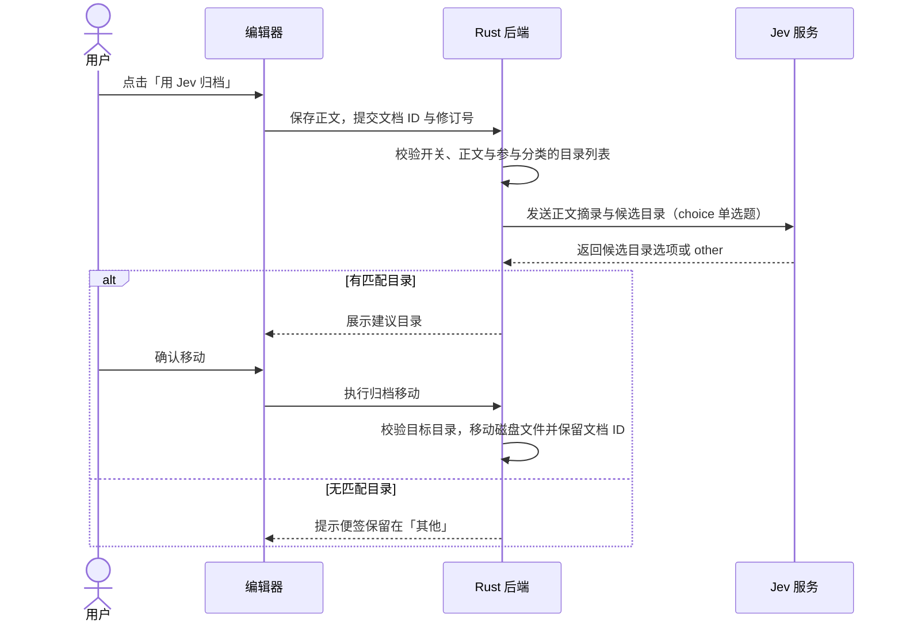

# Jotiva 架构与实现说明

[开发者指南](developer-guide.md) · [测试与发布](verification.md) · [English](en/architecture.md)

本文档概括 Jotiva 的跨平台边界、编辑器与窗口调度模型、防冲突保存机制以及 Jev 归档协议，供贡献者快速建立全局认知。

---

## 1. 桌面平台边界

Jotiva 将**文档实体（文档 ID）**与**系统窗口句柄**彻底解耦：即使宿主应用窗口关闭，对应便签依然保留完整身份与正文，可以重新挂载到其他窗口，或在主窗口、独立文档窗口中打开同一份文件。

业务层统一通过 `src-tauri/src/platform/contract.rs` 中的 `HostBackend`、`FileManager` 等抽象与系统交互，平台差异收敛在 `src-tauri/src/platform/{macos,windows,linux}/` 与共用的 `platform/shared/` 中：

| 能力 | macOS | Windows | Linux |
| --- | --- | --- | --- |
| **窗口与 WebView** | AppKit 标题栏，主窗叠加系统红绿灯 | 自绘标题栏与控制按钮、WebView2 | 自绘标题栏、WebKitGTK |
| **浮窗与宿主追踪** | `NSPanel`、Spaces、Accessibility（能明确识别宿主窗口时可跨重启恢复挂载） | Win32 枚举、前景与关闭监听（运行期内关联） | X11/EWMH 枚举与事件监听；原生 Wayland 仅使用独立便签 |
| **文件管理器定位** | Finder 选中目标文件 | Windows Shell 定位并选中 | Tauri opener 调用桌面文件管理服务 |
| **原子文件替换** | Darwin 文件交换 | `ReplaceFileW` | Linux `renameat2` |
| **密钥与凭据存储** | macOS 钥匙串 | Windows 凭据管理器 | Secret Service（配合 `secret-tool` 与 `zenity`） |

---

## 2. 窗口调度与编辑器生命周期

- **单入口多视图**：所有窗口共用一个前端入口，由 `src/main.ts` 根据窗口标签（`main`、`settings`、`quick` / `quick-*`、`document-*`）加载对应视图。
- **低内存与快切标签**：主窗口同一时间仅运行当前激活标签的编辑器实例与 Worker；切走标签前先冲刷待保存内容，并保留撤销历史、选区、滚动位置与编辑模式（即时预览 / 源码）。每个独立文档窗口持有独立的编辑会话。
- **时序安全与资源回收**：`desktop.rs` 通过递增的 `epoch` 编号协调速记窗口状态切换，WebView 准备好对应视图后带回同一 `epoch` 确认，丢弃过期响应。折叠便签后会回收 Worker，隐藏窗口超过空闲期后可释放 WebView，仍可从菜单栏或系统托盘重新唤起，也可使用已注册的全局热键。

---

## 3. 增量解析、保存与防冲突合并

1. **输入先显示，后台增量解析**：用户输入立即反馈在编辑器中，由 `editor.worker.ts` 内的 Rust/Wasm 引擎增量解析并优先投影视口附近内容；停止输入片刻后的延时保存会等待 Worker 确认正文后再提交给后端。
2. **原子写入与冲突保护**：Rust 端通过文档 ID 校验期望修订号与磁盘当前内容，先在同目录写入临时文件再执行原子替换；若元数据提交失败则尝试恢复原文件，并保留原文件的 `CRLF` / `LF` 换行风格。
3. **多窗口同步与冲突恢复**：同一文档在多个窗口打开时，若各窗口修改了互不重叠的区域，前端会尝试自动合并（`document-sync.ts`）；若存在重叠冲突或被外部应用修改，前端提供「**另存编辑并重载**」，将未保存修改安全存至「归档 → 其他」后再加载磁盘最新版本。

---

## 4. 本地数据布局

应用状态目录由 Tauri 的 `app_data_dir()` 决定（例如 macOS `~/Library/Application Support/io.github.lin037.jot.desktop/`、Windows `%APPDATA%\io.github.lin037.jot.desktop`、Linux `$XDG_DATA_HOME/io.github.lin037.jot.desktop`，未设置 `XDG_DATA_HOME` 时使用 `~/.local/share`）。

| 路径 | 用途 |
| --- | --- |
| `notes/其他/*.md` | 默认归档收件箱中的真实 Markdown 文件（新建窗口便签时即创建空文件）。 |
| `notes/<id>.json` | 便签正文快照、修订号、标题、归档路径与来源记录。 |
| `notes/window-bindings.json`、`notes/sources.json` | 窗口关联状态与手动登记来源；`notes/closing-sources/` 记录解除中状态以便重启续接。 |
| `workspace.json`、`folders.json` | 工作区根目录列表（展开目录时按级懒读取）及归档目录显示名、说明与分类开关。 |
| `appearance.json`、`settings.json` | 当前主题、排版偏好、全局样式微调及快捷键覆写配置。 |
| `themes/` | 导入的 CSS 主题文件。 |
| `filing.json` | Jev 归档开关、服务地址与模型名（API 密钥不落明文文件，仅存系统凭据库）。 |

---

## 5. Jev 归档交互流程

- 后端仅在用户主动触发时发起请求，将目标目录编码为 Jev `choice` 协议的 `questions.destination`（选项键如 `folder_<id>`，含名称与用途说明，`other` 表示无匹配）。
- 远程地址强制 HTTPS（仅 `127.0.0.1` 与 `[::1]` 允许 HTTP），不跟随重定向，单次请求超时 25 秒，对超时、连接失败或 502/503/504 会在 750 毫秒后重试一次。相关实现位于 [settings/filing.rs](../src-tauri/src/settings/filing.rs)。
