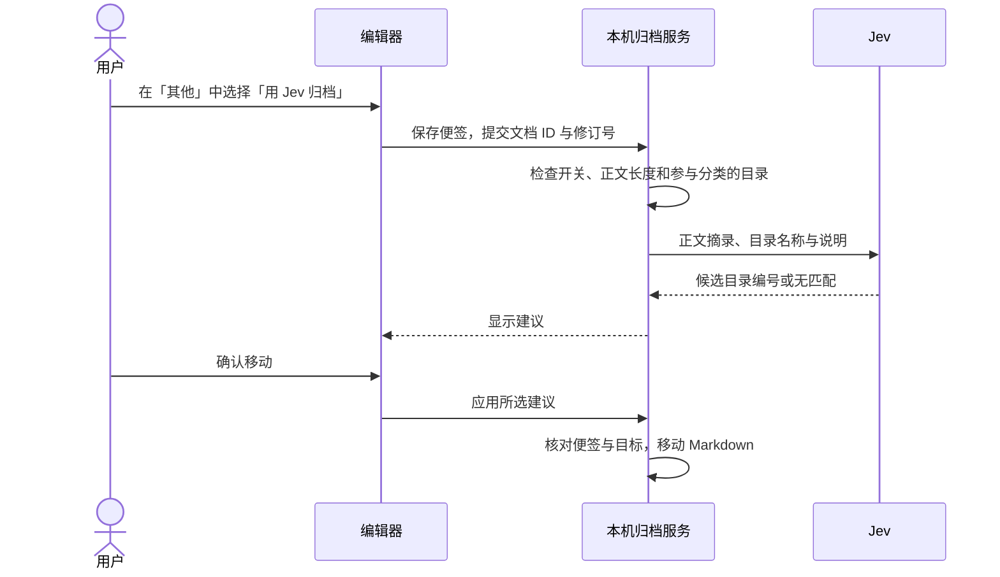

# Jotiva 实现说明

[开发者指南](developer-guide.md)

## 窗口与编辑器

TypeScript 根据 Tauri 的窗口标签加载视图。主窗 `main`、设置 `settings`、速记 `quick` 和 `quick-*`、独立文档 `document-*` 共用同一个 HTML 入口。主窗同时只运行当前标签的编辑器和 Worker，切走时保存正文，再保留该标签的撤销快照、选区、阅读位置和编辑模式。打开另一扇独立文档窗会多出一份独立编辑会话。

速记由 `desktop.rs` 协调，额外速记窗在 `desktop/note_windows.rs` 管理。Rust 用递增的 `epoch` 标记视图切换，WebView 在准备好编辑、摘要或搜索界面后用同一个编号确认。旧确认会被丢弃。折叠便签后可回收 Worker，隐藏窗口经过空闲期后可销毁 WebView。仅菜单栏常驻时仍可以用热键唤起。 [窗口事件定义](../src-tauri/src/events.rs)

macOS 宿主观察使用 AppKit 和 Accessibility。窗口能唯一确认时，Jotiva 会恢复绑定。系统窗口已重建时，自动恢复依赖宿主提供的稳定文档身份，遇到歧义就留在「待重新挂载」。标题可用于列表筛选。被动切回宿主会恢复便签的显示，键盘焦点仍留在宿主。 [宿主代码](../src-tauri/src/host/mod.rs)

## 文档怎样保存

1. 输入先到编辑器，延时保存会等待 Worker 确认正文。切换、关闭和退出也会先处理待保存的输入。
2. Rust 用文档 ID 找到记录，检查版本及磁盘内容。替换 Markdown 前在同目录写入临时文件，检查旧内容后替换目标。记录提交失败时尝试恢复原文件。
3. Jotiva 的其他窗口收到更新后可以读取新版本。若本地和另一窗口修改了不同范围，前端会尝试合并。遇到重叠、外部编辑产生的保存冲突或目标无法读取时，界面可以把尚未保存的输入另存到「其他」。
4. 便签从「其他」移到用户目录时保留文档 ID。文档绑定与文件位置独立，解除挂载后仍能打开原文。

[编辑会话](../src/editor/note-editor.ts) · [文本合并](../src/editor/document-sync.ts) · [文件写入](../src-tauri/src/storage.rs)

## 本地数据

应用数据目录为 `~/Library/Application Support/io.github.lin037.jot.desktop/`。

| 路径 | 内容 |
| --- | --- |
| `notes/其他/*.md` | 默认归档中的真实文档。新建的无名速记在首次保存正文后写入。 |
| `notes/<id>.json` | 便签正文快照、修订号、标题、归档路径和来源。 |
| `notes/window-bindings.json`、`notes/sources.json` | 窗口身份与手动登记的来源。 |
| `notes/closing-sources/` | 解除来源时的中间状态，用于下次启动继续处理。 |
| `workspace.json`、`folders.json` | 工作区目录，归档名称、路径、说明和分类选择。 |
| `appearance.json`、`settings.json` | 外观和快捷键。快捷键设置保存三项全局键位及用户改过的应用内键位。 |
| `filing.json` | Jev 归档开关、服务地址和模型名称。密钥由原生端读写 macOS 钥匙串。 |

归档设置页按表单里的地址查询密钥状态。WebView 只收到是否已配置或查询错误。输入和更换密钥通过原生密码框完成，保存归档偏好可以单独进行。

从 Finder 或工作区打开的 Markdown 留在原位置。注册工作区只是把路径存起来，展开目录时才读取那一级的子项。 [便签库](../src-tauri/src/library/notes.rs) · [工作区](../src-tauri/src/library/workspace.rs)

应用内默认键位由 `src/desktop/shortcut-commands.json` 和 `shortcut-editor.json` 定义。设置页、AppKit 菜单和编辑器共用这两份清单。保存后，各窗口收到更新事件，已打开的文档也会使用新键位。系统编辑操作、方向键选择和特定控件的导航操作列在 `shortcut-reference.json`。 [快捷键说明](shortcuts.md)

## Jev 归档

归档对接 Jev 协议的 `choice` 类型。每次请求只有一道单选题 `questions.destination`。每个参与分类的目录占一个选项，键为 `folder_<id>`，说明包含目录名称和用途。服务在 `answers.destination` 返回 `type: "choice"` 和选中的 `choice`，例如 `folder_7`。选择 `other` 表示没有匹配。Jotiva 校验返回值，用本地目录记录查找磁盘路径。 [请求与响应处理](../src-tauri/src/settings/filing.rs)

自建服务可以使用路径前缀。例如基础地址 `https://example.org/team` 对应的 POST 地址是 `https://example.org/team/v1/systemone`。基础地址以 `/v1` 结尾时只追加 `/systemone`。「完整接口地址」直接使用填写的请求路径。远程接口必须使用 HTTPS。HTTP 仅接受本机回环地址 `127.0.0.1` 和 `[::1]`，可以指定端口。Jotiva 会直接连接这两种地址上的服务。密钥与最终的请求地址绑定，原生端从 macOS 钥匙串读取密钥并设置 Bearer 认证，请求不跟随重定向。 [原生网络与钥匙串](../src-tauri/src/settings/filing.m)

每次网络请求限时 25 秒。连接中断、超时或 HTTP 502、503、504 会在 750 毫秒后重试一次，发送前再次核对请求是否有效。认证错误、限流和格式异常会在编辑器中提示。用户可以修改设置或稍后再发起一次。模拟服务的测试入口是 `pnpm test:filing`。 [测试说明](verification.md)
