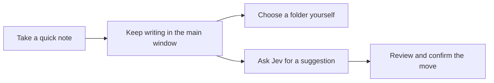

# HelloJotiva

Open this file in Jotiva. Edit a line or check off a task and the change is saved back to the Markdown file. You can try the shortcuts and settings below in the app.

## Leave a note beside a window

On a desktop that supports window attachment, open a blank browser window and press `Control+Shift+Space` to bring up a note. Jot down a shortcut you want to try. Press `Cmd+Enter` on macOS or `Ctrl+Enter` on Windows and Linux to return focus to the browser.

## Keep writing in Jotiva

Choose **Edit in main window** from the note menu to open the same file. Try adding a remark to the table of default shortcuts. Click inside a cell to edit it, press `Tab` to move forward, or press `Shift+Tab` to go back.

| Action | macOS | Windows / Linux | Notes |
| --- | --- | --- | --- |
| Find notes and documents | `Cmd+K` | `Ctrl+K` |  |
| Switch preview / source | `Cmd+/` | `Ctrl+/` |  |
| Move between panes | `F6` | `F6` |  |
| Save | `Cmd+S` | `Ctrl+S` |  |

- [ ] Switch to source, then back to Live Preview.
- [ ] Find the note you just wrote with search.

## File the note

New quick notes start in **Archive → Inbox**. When a note is ready, pick a folder yourself or enable Jev and choose **File with Jev**. The model uses a note excerpt and the candidate folders' names and descriptions. You can review its suggestion before confirming the move.



## Make body text smaller

The default theme multiplies the base font size by $1.13$ to get the body font size. With a base size of 14 px, the body text is about 15.8 px.

$$
s_{\mathrm{body}} = 14\,\mathrm{px} \times 1.13 = 15.82\,\mathrm{px}
$$

To make body text 1 px smaller than the base size in the main and standalone document windows, save this under **Settings → Appearance → Global CSS tweaks**.

```css
:root {
  --jot-editor-font-size: calc(1rem - 1px);
}
```

## Take images with the note

The colors in this abstract image are based on the built-in Blueprint theme. The image uses a relative path. Keep the `assets/hello-jotiva/` folder beside the note when you copy it, so the image opens offline.


