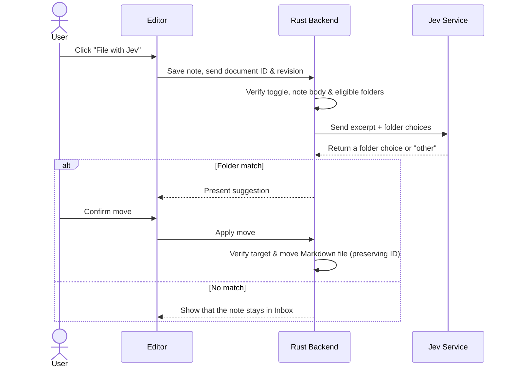

# Jotiva Architecture

[Developer Guide](developer-guide.md) · [Verification & Releasing](verification.md) · [简体中文](../architecture.md)

This document summarizes Jotiva's platform boundaries, window and editor lifecycle, conflict-safe saving, local data layout, and Jev filing protocol.

---

## 1. Platform Boundaries

Jotiva decouples **document identity (document ID)** from **OS window handles**. Even after a host window closes, the note keeps its identity and content so it can be reattached to another window or opened in the main workspace and standalone document windows.

Business logic interacts with the OS through `HostBackend` and `FileManager` traits in `src-tauri/src/platform/contract.rs`, backed by per-OS modules under `src-tauri/src/platform/{macos,windows,linux}/` and shared Tauri helpers in `platform/shared/`:

| Capability | macOS | Windows | Linux |
| --- | --- | --- | --- |
| **Main, settings, document windows** | AppKit titlebar with native traffic lights | Custom titlebar, WebView2 | Custom titlebar, WebKitGTK |
| **Floating notes & host tracking** | `NSPanel`, Spaces, Accessibility (can restore attachments across restarts when the host window can be identified unambiguously) | Win32 window enumeration, foreground & close hooks (per-session) | X11/EWMH tracking; standalone notes on native Wayland |
| **Reveal in file manager** | Finder selection | Windows Shell reveal/select | Tauri opener via desktop file service |
| **Atomic file swap** | Darwin exchange | `ReplaceFileW` | Linux `renameat2` |
| **Credential storage** | macOS Keychain | Windows Credential Manager | Secret Service (`secret-tool` & `zenity`) |

---

## 2. Windows & Editor Lifecycle

- **Single entry, label-based routing**: All windows share one frontend bundle; `src/main.ts` mounts the matching view by Tauri window label (`main`, `settings`, `quick` / `quick-*`, `document-*`).
- **One active workspace editor**: The main window keeps only the active tab's editor and worker live. Switching tabs flushes pending edits and saves undo history, selection, scroll position, and mode (`live-preview` or `source`). Standalone document windows each run their own session.
- **Epoch handshake & reclamation**: `desktop.rs` tags quick-note view switches with a monotonically increasing `epoch` and drops stale acknowledgments. Collapsed notes can reclaim their worker, and idle hidden windows can release their WebView while staying reachable via a registered global shortcut or the menu bar / system tray.

---

## 3. Incremental Parsing, Saving & Sync

1. **Immediate input, worker parsing**: Keystrokes appear immediately in the editor while the Rust/Wasm engine in `editor.worker.ts` parses incrementally and prioritizes the viewport. Auto-save waits for worker confirmation before writing.
2. **Atomic disk replacement**: Rust looks up the document record by ID, verifies the expected revision and on-disk contents, writes a temporary file in the same directory, and performs an atomic swap—preserving the original `CRLF` or `LF` line endings.
3. **Cross-window sync & conflict recovery**: When the same document is open in multiple windows, Jotiva tries to merge non-overlapping edits (`document-sync.ts`). Overlapping edits or external disk changes prompt **Keep a copy and reload**, saving local unsaved edits into **Archive → Inbox** before reloading.

---

## 4. Local Data Layout

Application state lives under Tauri's `app_data_dir()` (`~/Library/Application Support/io.github.lin037.jot.desktop/` on macOS, `%APPDATA%\io.github.lin037.jot.desktop` on Windows, `$XDG_DATA_HOME/io.github.lin037.jot.desktop` on Linux, using `~/.local/share` if `XDG_DATA_HOME` is unset).

| Path | Contents |
| --- | --- |
| `notes/其他/*.md` | Plain Markdown files in the default Inbox (created empty when you start a window note). |
| `notes/<id>.json` | Note content snapshot, revision, title, archive path, and source info. |
| `notes/window-bindings.json`, `notes/sources.json` | Window attachments and registered sources (`notes/closing-sources/` tracks pending unbinds across restarts). |
| `workspace.json`, `folders.json` | Registered workspace roots (read lazily per expanded level) and archive folder metadata/Jev flags. |
| `appearance.json`, `settings.json` | Selected theme, typography, global CSS tweaks, and shortcut overrides. |
| `themes/` | Imported CSS theme files. |
| `filing.json` | Jev filing toggle, service URL, and model name (API keys stay in the OS credential store). |

---

## 5. Jev Filing Protocol

- Requests run only when triggered manually. Eligible folders are sent as a single `choice` question (`questions.destination`) with `folder_<id>` keys, names, and descriptions (`other` indicates no match).
- Remote endpoints require HTTPS (HTTP is restricted to `127.0.0.1` and `[::1]`), redirects are disabled, each request times out after 25s, and timeouts, connection failures, or HTTP 502/503/504 retry once after 750ms. See [settings/filing.rs](../../src-tauri/src/settings/filing.rs).
